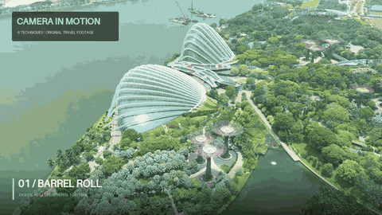
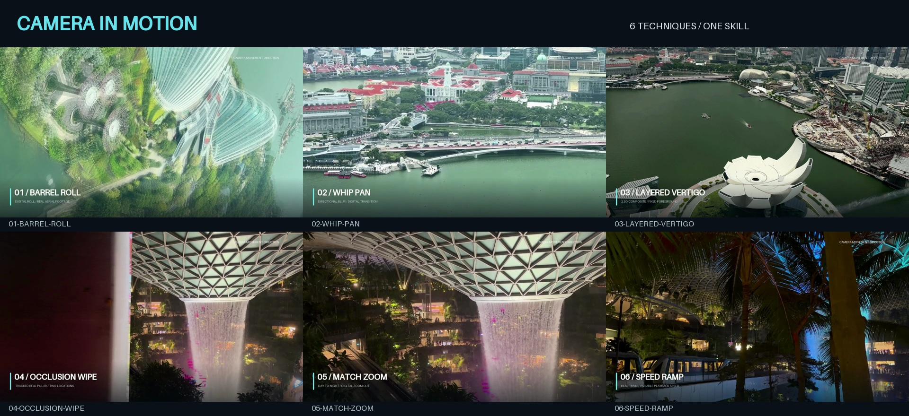

# camera-movement-skills

把运镜意图变成可执行、可检查的镜头：**12 个 skill · 38 项技法图谱 · 6 段现成示例**。

[](examples/showreel.mp4)

**[观看 28 秒完整展示片](examples/showreel.mp4)** · 1280 × 720 · 30 fps · 原创程序合成节拍与转场音效

这是一个面向 Codex 的运镜技能库，覆盖实拍规划、已有照片/视频后期和 AI 视频提示词。总控技能负责镜头目的与整片组织，视觉预处理技能负责诊断和资产准备，专项技能负责具体执行。你可以用自己的素材，也可以直接复现随包示例。

## 项目解决什么

- 把“更有电影感”“跟住人物”“从白天切到夜晚”写成起止构图、主体、运动路径和验收条件。
- 先检查素材，再选择需要的 CV 处理：跟踪、稳像、掩码、裁切、图层合成和时间映射按任务组合。
- 用参数化命令处理新输入，输出视频及 JSON 报告；展示片的固定时间线与通用工具分开维护。
- 清楚区分实拍、数字处理和 2.5D 合成，让示例的视觉效果与实际实现方式对应。

快速入口：[技能列表](#技能列表) · [安装](#安装) · [处理自己的素材](#处理自己的素材) · [CV 能力边界](docs/cv-capabilities.md) · [38 项图谱](docs/movement-catalog.md) · [八个场景配方](docs/shot-recipes.md)

## 技能列表

| Skill | 负责的任务 | 主要输入 → 输出 |
| --- | --- | --- |
| [camera-movement-direction](skills/camera-movement-direction/SKILL.md) | 运镜导演：选技法、安排分镜与整片节奏 | 场景/素材 → 镜头计划、执行路线、验收重点 |
| [camera-motion-prep](skills/camera-motion-prep/SKILL.md) | 视觉预处理：素材诊断、背景稳像与静态掩码准备 | 视频/图像、ROI/种子 → 诊断报告、处理视频或 alpha |
| [camera-reframe](skills/camera-reframe/SKILL.md) | 数字推拉、水平/垂直重构图 | 图像/视频、起止中心与倍率 → 裁切动画 |
| [camera-subject-track](skills/camera-subject-track/SKILL.md) | 跟住指定主体并维持构图 | 视频、初始主体区域 → 跟踪重构图 |
| [camera-barrel-roll](skills/camera-barrel-roll/SKILL.md) | 滚转、旋转余量和回正 | 视频、角度与节奏 → 数字滚转 |
| [camera-whip-pan](skills/camera-whip-pan/SKILL.md) | 以甩动和方向模糊连接镜头 | 两段视频、方向与时段 → 甩镜转场 |
| [camera-occlusion-wipe](skills/camera-occlusion-wipe/SKILL.md) | 按遮挡边缘揭示下一场景 | 两段视频、对应逐帧掩码 → 遮挡切换 |
| [camera-match-zoom](skills/camera-match-zoom/SKILL.md) | 对齐视觉锚点并切换地点或时段 | 两段画面、两侧锚点与倍率 → 匹配变焦 |
| [camera-speed-ramp](skills/camera-speed-ramp/SKILL.md) | 组织行进与动作的快慢节奏 | 视频、时长与速度曲线 → 时间重映射 |
| [camera-layered-vertigo](skills/camera-layered-vertigo/SKILL.md) | 固定主体、反向缩放背景 | 前景、背景、alpha → 2.5D 眩晕合成 |
| [camera-depth-parallax](skills/camera-depth-parallax/SKILL.md) | 图层间有限的横纵视差 | 分层资产、相对位移 → 2.5D 视差合成 |
| [camera-ai-video-prompts](skills/camera-ai-video-prompts/SKILL.md) | 为目标生成平台组织镜头语言 | 场景/参考、目标动作 → 镜头规格与提示词 |

12 个 skill 包括 **1 个导演、1 个视觉预处理、9 个后期执行和 1 个 AI 提示词技能**。38 项图谱是镜头语言与实现条件的覆盖范围，不能据此推断每项都有自动执行命令或现成演示。

## 安装

需要 Python 3、[Python 依赖](requirements.txt)，以及带 `libx264` 的 FFmpeg。显式 HDR 转换还需要 FFmpeg 的 `zscale` 和 `tonemap` 滤镜。

先获取仓库并进入项目目录：

```bash
git clone https://github.com/Yang-Jiashu/camera-movement-skills.git
cd camera-movement-skills
```

```bash
python3 -m pip install -r requirements.txt
python3 scripts/install_skills.py
```

安装器会同时安装技能和共享运行时，默认目标为 `$CODEX_HOME/skills`，未设置时使用 `~/.codex/skills`。已有不同版本时，按安装器提示使用 `--upgrade` 备份后替换；`--dry-run` 可以先查看计划，`--dest` 可指定目录。直接使用仓库 CLI 时，可跳过技能安装。

也可以只安装需要的技能；重复 `--skill` 选择多个，运行时依赖会一并安装：

```bash
python3 scripts/install_skills.py --skill camera-motion-prep --skill camera-reframe
```

```bash
python3 scripts/install_skills.py --help
```

在 Codex 中调用：

```text
用 $camera-movement-direction 分析我的旅拍素材，设计一支有空间感的短片。
先判断是否需要稳像、跟踪或掩码，再给出各镜头的起止构图并执行。
```

```text
用 $camera-barrel-roll 处理我的航拍视频，完整滚转一圈后回正。
先检查旋转裁切余量，保留清楚的起点和结束构图。
```

## 处理自己的素材

先提供：素材路径与区间、输出画幅和时长、主体或锚点、观看目的，以及希望保留的声音。需要分层时，再提供对应的前景、背景和 alpha。

下面两条命令使用随包素材，可以替换输入路径与参数。把 `/path/to/ffmpeg` 改为本机可执行文件路径；重复输出同名文件需明确加 `--overwrite`。

```bash
python3 scripts/apply_camera_motion.py reframe --input media/jewel-night.mp4 --output outputs/push.mp4 --width 640 --height 360 --duration 1 --zoom-start 1.05 --zoom-end 1.35 --center-start 0.5 0.5 --center-end 0.61 0.5 --max-upscale 1 --ffmpeg /path/to/ffmpeg

python3 scripts/apply_camera_motion.py roll --input media/gardens.mp4 --output outputs/roll.mp4 --width 640 --height 360 --duration 1.5 --angle-start 0 --angle-end 360 --max-upscale 1 --ffmpeg /path/to/ffmpeg
```

中心、锚点和 ROI 使用归一化坐标；角度单位为度；图层位移按输出宽高的比例填写。倍率相对于可容纳的最大同画幅裁切，具体参数以各子命令 `--help` 为准。

在决定是否稳像之前，可以先诊断一秒真实街景：

```bash
python3 scripts/prepare_motion.py analyze --input media/street.mp4 --output outputs/street-motion.json --duration 1 --ffmpeg /path/to/ffmpeg
```

该命令输出运动拟合与质量报告。自己的素材如有运动前景，可根据样帧用 `--background-roi X Y WIDTH HEIGHT` 指定静态背景区域；有效拟合本身不代表算法理解了背景身份。静态前景提取使用 `mask`，需要先观察图像并给出主体 ROI/种子，不能将一个 alpha 直接套到移动视频的所有帧上。

```bash
python3 scripts/apply_camera_motion.py --help
python3 scripts/prepare_motion.py --help
```

通用执行入口有九类后期技法及显式 `convert-hdr` 转换；视觉预处理入口提供 `analyze`、`stabilize`、`mask`。选用规则与算法输入输出见 [CV 能力矩阵](docs/cv-capabilities.md)。

## CV 能力与实现边界

| 层次 | 当前提供什么 | 使用条件 |
| --- | --- | --- |
| **已实现并有运行验证的后期执行** | 等比裁切/旋转、稀疏特征跟踪、掩码/alpha 合成、方向模糊、单调时间映射、显式 Hable HDR 转换 | 使用可解码输入；检查各输出 JSON 与视觉结果 |
| **本地视觉预处理，已有独立小样本校验** | 元数据与背景 ROI 运动诊断、LK/RANSAC 轨迹稳像、ROI/种子辅助 GrabCut 静态 alpha | 明确选背景或主体；静态掩码不能直接当作视频分割 |
| **需要手工资产或设计的流程** | 遮挡物逐帧掩码、分层轮廓与背景补洞、视觉锚点、实拍与生成镜头规格 | 用户准备或按技能流程逐项制作并核查 |
| **可选外部模型，当前无内置自动调用** | 语义检测、视频分割传播、单目深度、专门插帧或多视图重建 | 另配模型、权重和环境，结果经过检查后作为显式输入 |
| **单片信息不足时无法保证恢复** | 未拍到的背面、真实大幅环绕、准确三维结构、失焦中未记录的细节 | 补拍、多视角/三维资产，或明确选择生成推断 |

算法围绕镜头任务按需配置。例：数字推近通常只需要读取、裁切路径和边界检查；主体跟随才需要 ROI 特征跟踪；分层视差才需要 alpha 与背景覆盖。完整的任务—算法—输入输出映射见 [CV 能力文档](docs/cv-capabilities.md)。

## 一次处理怎样完成

1. **诊断输入**：读取实际画面和元数据，确认颜色、时间线、有效画幅及已有运动。
2. **决定观看目的**：写清主体、起止构图和最后获得的信息。
3. **只准备必要资产**：根据问题做稳像、主体 ROI、掩码或图层准备。
4. **执行专项技能**：把中心、倍率、角度、速度或 alpha 时序转成可复现参数。
5. **检查输出**：核对几何与时间报告，完整解码，再观看完整动作与前后切点。
6. **组合交付**：组织镜头、声音、示例与说明，标明实际实现方法。

分层结构、输入契约与技能组合方式见 [架构与工作流](docs/architecture.md)。

## 六段现成示例

| 主片时段 | 技法 | 这段实际怎样实现 | 独立示例 |
| --- | --- | --- | --- |
| 00–04 秒 | **Barrel Roll** | 真实高处视频上的数字 360° 滚转 | [01](examples/01-barrel-roll.mp4) |
| 04–08 秒 | **Whip Pan** | 街景与湾岸之间的数字甩镜转场 | [02](examples/02-whip-pan.mp4) |
| 08–12 秒 | **Layered Vertigo** | 艺科馆固定前景与反向缩放背景的 2.5D 合成 | [03](examples/03-layered-vertigo.mp4) |
| 12–16 秒 | **Occlusion Wipe** | 沿机场真实立柱的逐帧边缘揭开夜景 | [04](examples/04-occlusion-wipe.mp4) |
| 16–20 秒 | **Match Zoom** | 白天照片画布与夜间实拍之间的匹配变焦 | [05](examples/05-match-zoom.mp4) |
| 20–24 秒 | **Speed Ramp** | 19.5 秒连续列车视频的时间重映射 | [06](examples/06-speed-ramp.mp4) |

24–28 秒以回闪与片名结束。GIF 是四段效果加速拼成的八秒预告；完整动作、节奏和声音以 MP4 为准。



示例的来源与观察重点见 [六段技法说明](docs/techniques.md)。

## 复现展示片

```bash
python3 scripts/render_showcase.py --input-dir media --output-dir examples --ffmpeg /path/to/ffmpeg
python3 scripts/build_previews.py --examples-dir examples --docs-dir docs --ffmpeg /path/to/ffmpeg
```

`media/` 包含规范化的演示输入、掩码和图层，复现不需要原始 4K 文件。渲染入口先重建分层片段，再组织主片和原创程序合成节拍。

## 验证与限制

- 六段示例与 28 秒主片已经过完整解码和视觉检查；通用九类后期命令有真实素材短导出验证。
- 独立前向测试仅依据 `--help` 完成了偏心推近、完整滚转与有限视差；缺输入、已有文件和越界路径三类失败检查保留了原输出与报告。
- 已通过 14 项基础回归检查（8 项视觉预处理、6 项几何/时间映射）：`python3 -m unittest discover -s tests -v`。运行记录见 [主片验收](docs/validation.json)、[通用工具验收](docs/validation-runtime.json)、[视觉验收](docs/visual-review.json)。
- 预处理另有 [独立编码画面检查](docs/validation-cv-independent.json)：用不同的 ECC 估计器复查一个 60 帧已知抖动样本，确认抖动减少且没有空黑边；另核查简单静态掩码与真实片段运动诊断。该小样本不代表普遍准确率。
- [真实素材与失败保护记录](docs/validation-cv.json) 覆盖背景诊断、夜景稳像、HDR拒绝和发布失败回滚。真实建筑的初版GrabCut掩码仍有误分，已标记需要人工修订，不能直接作为合成成品。
- 安装检查覆盖干净技能目录中只安装预处理 skill、重复安装幂等，以及安装后的入口实际输出 15 帧诊断。
- 通用管线按 **CFR 帧索引**处理；当前不自动识别 VFR。需要精确时序或原声同步的 VFR 输入应先规范化。
- 默认输出静音；`--audio source` 仅适用于不改变时间线的单视频处理。多镜头和变速后的声音需要另行混合。
- ROI 跟踪利用局部纹理，不识别人或物体身份；分层合成依赖显式图层，无法自动证明隐藏区域的真实性。
- 高速过渡的短时放大与清楚观察段应分别评估。旋转、稳像和改画幅共同消耗裁切余量。

## 文档与目录

| 文档 | 用来回答什么 |
| --- | --- |
| [38 项图谱](docs/movement-catalog.md) | 每种动作是什么，实拍、后期、AI 分别需要什么 |
| [八个场景配方](docs/shot-recipes.md) | 建筑、街巷、人物、美食、水景、产品、开场和结尾怎样设计 |
| [CV 能力矩阵](docs/cv-capabilities.md) | 每个处理任务采用什么算法，输入输出与当前边界是什么 |
| [架构与工作流](docs/architecture.md) | 诊断、资产准备、专项执行与验收如何组合 |
| [示例说明](docs/techniques.md) | 六段现成效果的真实来源和实现方式 |

```text
skills/       12 个 skill、专项参考与已安装启动入口
scripts/      通用执行、视觉预处理、安装器与示例复现代码
tests/        几何、时间映射及相关回归检查
media/        规范化演示视频、照片、掩码与图层
examples/     展示主片、六段独立示例与渲染报告
docs/         图谱、配方、架构、能力说明与验收记录
```

## 媒体来源与许可证状态

演示画面来自作者自有的新加坡旅行照片与视频；逐项来源见 [media/provenance.json](media/provenance.json)。主片节拍、低频、打击乐与风切由程序合成，未使用第三方音乐。分层示例的部分遮挡水面使用已有背景补洞，已在示例文档中说明。

仓库当前未附代码或媒体的开源许可证；具体使用与再分发授权由作者另行说明。Python 库、FFmpeg 及可选模型各自的许可证保持独立。
