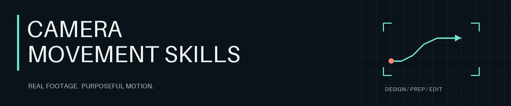
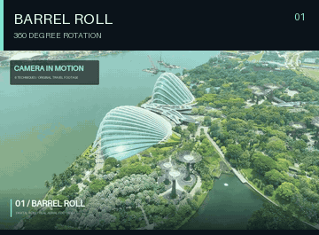
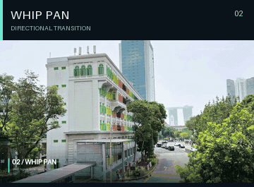
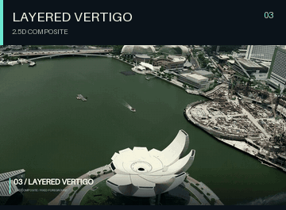
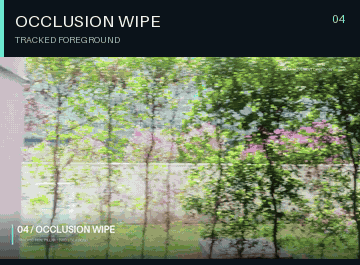
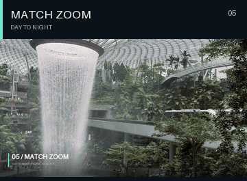
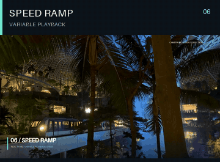
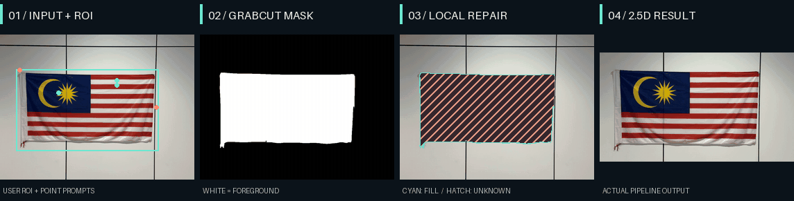

<p align="center">
  
</p>

<p align="center">给 Codex 的运镜工作流：把自己的照片与视频，剪成有节奏的镜头。</p>
<p align="center"><b>12 个 skills · 38 项技法 · 6 组主展示</b></p>
<p align="center">
  <a href="examples/showreel.mp4">▶ 观看 28 秒完整展示片</a> ·
  <a href="#5-分钟开始">开始使用</a> ·
  <a href="docs/movement-catalog.md">技法图谱</a> ·
  <a href="docs/getting-started.md">入门指南</a>
</p>

## 先看画面

<table>
  <tr>
    <td width="33%"><a href="examples/01-barrel-roll.mp4"></a></td>
    <td width="33%"><a href="examples/02-whip-pan.mp4"></a></td>
    <td width="33%"><a href="examples/03-layered-vertigo.mp4"></a></td>
  </tr>
  <tr>
    <td width="33%"><a href="examples/04-occlusion-wipe.mp4"></a></td>
    <td width="33%"><a href="examples/05-match-zoom.mp4"></a></td>
    <td width="33%"><a href="examples/06-speed-ramp.mp4"></a></td>
  </tr>
</table>

点击动图观看对应独立成片。示例来自真实旅行素材；分层眩晕为 2.5D 合成。完整展示片另含原创节拍和音效。

**一张照片 → 掩码与有限补洞 → 视差成片**

[](examples/pipeline/auto-parallax.mp4)

由原图与用户 ROI / 提示点实际生成图层。青色是可见补洞带，斜线区是仍未知的隐藏核心。[复现此流程](docs/getting-started.md#复现首页的-cv-流程) · [自动视频掩码转场](examples/pipeline/auto-wipe.mp4)

## 5 分钟开始

准备 Python 3、FFmpeg（含 `libx264`；HDR 转换另需 `zscale` / `tonemap`），然后安装：

```bash
git clone https://github.com/Yang-Jiashu/camera-movement-skills.git
cd camera-movement-skills
python3 -m pip install -r requirements.txt
python3 scripts/install_skills.py
```

在 Codex 中给出素材路径与想要的效果：

```text
用 $camera-movement-direction 剪辑 /path/to/my-video.mp4。
先判断素材适合什么运镜，做一段有节奏的旅行开场，输出 1280×720。
```

也可以先用仓库素材试一次数字推近：

```bash
python3 scripts/apply_camera_motion.py reframe \
  --input media/jewel-night.mp4 --output outputs/push.mp4 \
  --width 640 --height 360 --duration 1 \
  --zoom-start 1.05 --zoom-end 1.35 --center-end 0.61 0.5
```

更新已有安装加 `--upgrade`；按需安装加 `--skill 技能名`。安装器自动处理共享运行时。更多输入要求、命令和复现方式见 [入门指南](docs/getting-started.md)。

## 按镜头目的选择

总控技能负责选技法和安排节奏；明确要做某一种效果时，可直接调用对应技能。

<details>
<summary><b>展开全部 12 个 skills</b></summary>

| 工作 | 技能 |
| --- | --- |
| 设计与准备 | [运镜导演](skills/camera-movement-direction/SKILL.md) · [视觉预处理](skills/camera-motion-prep/SKILL.md) · [AI 视频提示词](skills/camera-ai-video-prompts/SKILL.md) |
| 单镜头运动 | [推拉重构图](skills/camera-reframe/SKILL.md) · [主体跟随](skills/camera-subject-track/SKILL.md) · [滚转](skills/camera-barrel-roll/SKILL.md) · [速度渐变](skills/camera-speed-ramp/SKILL.md) |
| 转场与空间 | [甩镜](skills/camera-whip-pan/SKILL.md) · [遮挡转场](skills/camera-occlusion-wipe/SKILL.md) · [匹配变焦](skills/camera-match-zoom/SKILL.md) · [分层眩晕](skills/camera-layered-vertigo/SKILL.md) · [2.5D 视差](skills/camera-depth-parallax/SKILL.md) |

</details>

## 能力与边界

本地可执行数字运镜、主体跟随、转场与变速，已内置视频掩码传播、有限分层补洞和 SIFT 视觉锚点匹配。分层空间效果属于 2.5D；深度模型、任意视频语义分割和三维重建需外部流程。算法、音频、CFR 时间轴和验证范围见 [能力矩阵](docs/cv-capabilities.md)。

38 项技法包含实拍规划、现有素材处理和 AI 设计路线；主展示为上面的 6 项，另有可复现的 CV 管线样例。

## 继续探索

| 想了解什么 | 从这里开始 |
| --- | --- |
| 如何使用、复现和排错 | [入门指南](docs/getting-started.md) |
| 什么镜头适合什么目的 | [38 项技法](docs/movement-catalog.md) · [8 个场景配方](docs/shot-recipes.md) |
| CV 算法、依赖和处理组合 | [能力矩阵](docs/cv-capabilities.md) · [工作流设计](docs/architecture.md) |
| 六个示例如何做出来 | [示例实现](docs/techniques.md) · [素材来源](media/provenance.json) |

演示使用作者的新加坡旅行素材，配乐由程序合成。代码与媒体尚未指定开源许可证；第三方依赖遵循各自许可。
