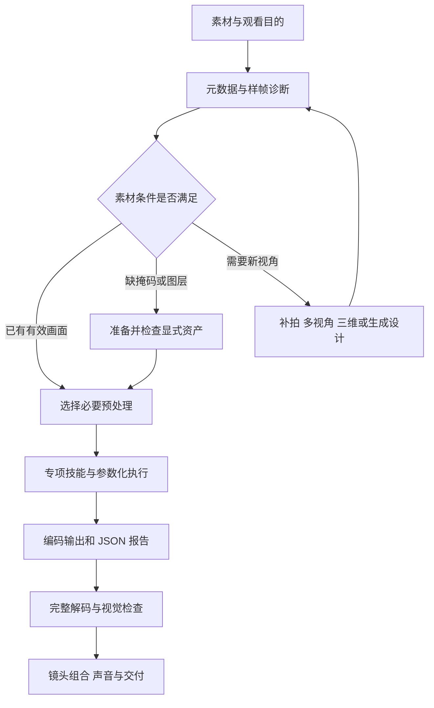

# 架构与工作流

项目把“镜头应该怎样被观看”与“画面具体怎样计算”分开处理。技能负责目标、选择和验收，CLI 负责有边界的处理，显式资产承载主体、掩码和图层。复杂效果由必要环节组合，不把全部 CV 算法套在每段素材上。

## 四层结构

| 层 | 文件与入口 | 主要责任 |
| --- | --- | --- |
| 镜头设计 | `camera-movement-direction`、38 项图谱、场景配方 | 明确叙事目的，选择动作与实现路线，组织整片 |
| 视觉预处理与资产 | `camera-motion-prep`、`scripts/prepare_motion.py`、用户提供的 ROI/掩码/图层 | 诊断素材，按需稳像或准备静态 alpha，核对资产与源片对应 |
| 专项执行 | 9 个后期执行 skill、`scripts/apply_camera_motion.py`、`scripts/motion_core.py` | 参数化几何、跟踪、转场、分层与时间处理 |
| 报告与展示 | 输出旁的 JSON、`tests/`、`examples/`、`render_showcase.py` | 记录实际方法与检查结果，生成可复现的独立片段和主片 |

`camera-ai-video-prompts` 为生成视频整理镜头规格与检查要求。它属于设计路线；当前本地运行时不内置某家视频生成 API。生成结果要参与后期时，将其作为新的媒体输入重新诊断。

## 从请求到交付



诊断决定后续动作：原片本来稳定时可直接进入裁切；已有运动与构图适合目标时可保留原片；需要局部跟随才初始化主体 ROI；需要分层效果才准备 alpha 和背景板。

## 处理环节如何预设计

每个镜头先写一条处理计划，并把计划值与已验证结果分开：

```text
镜头目的 / 输入区间 / 输出画幅与时长
已有运动与素材问题
需要的预处理及判断依据
主体、背景 ROI、锚点或掩码来源
起止参数、变化曲线、失败回退
应输出的媒体、报告和验收重点
```

### 配方示例

| 请求 | 必要环节 | 可以省去什么 |
| --- | --- | --- |
| 固定画面缓慢推近水幕 | 读取颜色/时序 → 设偏心中心与倍率 → 边界与采样检查 → 重构图 | 没有跟随或合成需求时，无需目标检测、深度、分割 |
| 跟住走动的人物 | 指定主体 ROI → 局部角点与稀疏光流 → RANSAC → 平滑构图 → 主体框留边 | 不需要把整幅场景重建为三维 |
| 减轻手持抖动但保留横摇 | 选择背景 ROI → 运动诊断 → 轨迹平滑与补偿 → 裁切预算 → 比较前后画面 | 不把水流或车辆运动当作相机抖动 |
| 沿柱子切换地点 | 核对两段时序 → 获取对应逐帧掩码 → 对齐分辨率与起始帧 → alpha 合成 → 看切点 | 已有可靠掩码时，无需重新分割；单帧 mask 不能替代整段序列 |
| 照片产生有限空间感 | 检查前景轮廓与完整背景 → 刚性层变换 → 有限相对位移 → 看新露出区域 | 没有全视角数据时，不承诺真实环绕 |

详细的可执行选择见 [CV 流程](../skills/camera-movement-direction/references/cv-pipeline.md) 和 [CV 组合配方](../skills/camera-movement-direction/references/cv-recipes.md)。

## 输入契约

### 媒体与时间

- 普通后期执行接收可解码 SDR 媒体；检测到 HDR 标记时先使用显式转换流程。
- 图像输入应是可读的 8-bit SDR；透明前景通过显式图层接口处理。
- 通用视频时间访问按 CFR 帧索引；当前不自动检测 VFR。需要精确时序时先将 VFR 规范化。
- 变速、跨镜头和分层效果默认静音；不变时间线的单视频效果可以显式保留对应原声。

### 坐标与几何

- 中心、锚点和 ROI 采用相应源/输出画面中的归一化坐标，具体语义由 `--help` 说明。
- 图层位移按输出宽高的比例表达，允许正负方向；角度使用度数。
- 缩放相对于可容纳的最大同画幅裁切；稳像、改画幅与旋转共用有效像素预算。
- 默认对越界报错。显式修正或允许放大应写入报告，不能静默把边缘修补当作真实原片内容。

### 掩码与图层

- 遮挡序列必须对应当前源片、画幅、起始帧和 mask fps；白色表示第二段视频显露。
- 分层 alpha 与前景同尺寸，白色表示前景；背景必须覆盖所请求的整个运动范围。
- `prepare_motion.py mask` 生成的是一个静态 alpha。视频中移动的遮挡物仍需要逐帧跟踪/分割和人工核查。
- 背景补洞、深度与语义分割来自外部资产时，记录方法和适用范围。

## 控制面和计算面

技能可以解释原因、提出取景与资产选择，也可以调用 CLI。CLI 不猜测主体身份、隐形结构、镜头情绪或模型生成结果的真实性；它只处理用户提供的图像、几何和时间要求。

示例的 `render_showcase.py` 使用随包素材编排固定展示。通用的 `apply_camera_motion.py` 接受新的输入与参数；共享计算在 `motion_core.py`，不把演示片中的地标名或像素坐标作为通用默认值。

## 安装与运行时

`install_skills.py` 安装所选技能，并将它们需要的共享运行时放到个人技能目录的 `.camera-motion-runtime`。技能的 `scripts/run.py` 作为已安装入口；直接在仓库执行 CLI 也可使用同一算法。

安装器检查已有副本；显式升级会先备份。Python 和 FFmpeg 依赖由使用者按项目要求安装，安装技能不会替代依赖安装。当前运行时文件与可用入口，以安装器和各 `--help` 的实际输出为准。

## 验收分层

1. **输入检查**：颜色标记、区间、主体/背景 ROI、图层尺寸、掩码时序。
2. **计算检查**：角点/内点置信、裁切边界、放大比、源帧索引与重复取帧情况。
3. **编码检查**：完整解码、输出尺寸、帧数、fps 和时长。
4. **视觉检查**：正常速度看完整动作；针对人物、建筑、遮挡边缘、滚转回正和变焦切点复查。
5. **交付检查**：区分实拍/数字/2.5D/生成，说明音轨处理，确保示例与文档链接可以使用。

某项输入或几何检查失败，应先调整路径、幅度或资产。需要额外模型、背景修补或新视角时，回到设计与资产准备阶段，避免把算法失败转成无依据的画面承诺。

完整能力清单与外部扩展边界见 [CV 能力矩阵](cv-capabilities.md)；现有展示片的实际方法见 [六段示例说明](techniques.md)。
